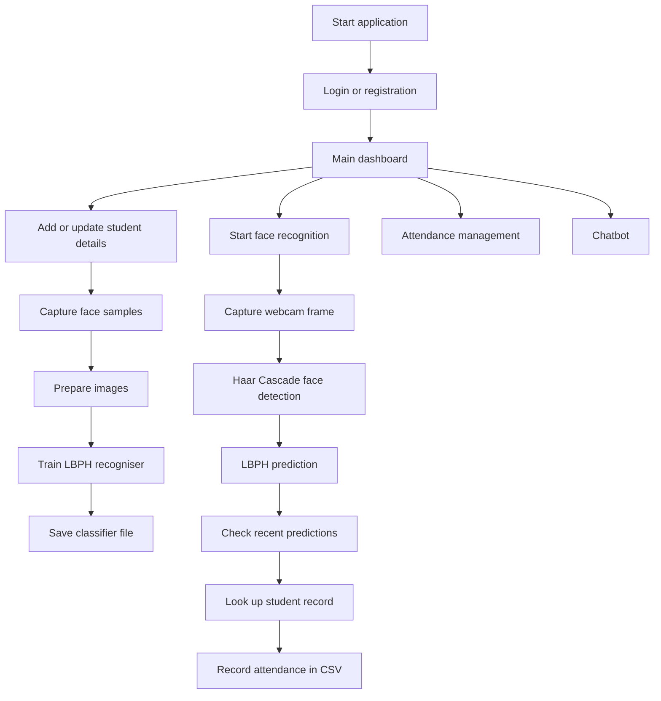

# Facial Recognition Attendance System

We built this Python desktop application as a four-student academic project. It brings student records, face-sample collection, facial recognition and attendance recording together in one application. It also includes a chatbot that connects to the Groq API.

The application uses a webcam to detect and recognise students who have been registered in the system. OpenCV handles the image-processing workflow, Haar Cascade detects faces in camera frames, and LBPH is used for facial recognition. Student and account information is stored in MySQL, while automatic attendance entries are written to a CSV report.

## What the application does

### Student records and face-sample collection

The Student Details section lets the user add, view, search, update and delete student records. The form includes details such as department, group, year, semester, student ID, name, course, registration number, gender, date of birth, email, phone number, address and proctor.

The same section can collect face samples using a webcam. The captured face images are converted to grayscale and saved in the `data` folder with filenames that include the student's ID. The capture process can collect up to 100 samples in a session and can be stopped earlier by pressing Enter.

### Face-model training

The training module reads the images saved in the `data` folder. It uses filenames in the `user.ID.number.jpg` format. Each image is read in grayscale, resized to 100 × 100 pixels and processed with histogram equalisation before training.

The application trains an LBPH face recogniser and saves the trained model as `classifier/classifier.xml`. The training code then checks that the saved file exists and can be loaded.

### Live face detection and recognition

When face recognition starts, the application opens the webcam and uses the included Haar Cascade XML file to detect faces in the camera frames. The frames are converted to grayscale and processed before the detected face regions are passed to the LBPH recogniser.

The application does not rely on a single prediction from one frame. It keeps a short history of predictions for each tracked face and checks that history against the recognition and consensus thresholds set in the code. When a face is recognised, the application looks up the matching student's details in MySQL and displays the result on the camera view.

### Automatic attendance recording

After recognising a student, the application can add an attendance entry to `attendance_report.csv`. Before writing the entry, it checks the student's ID and the date so that the same student is not automatically recorded more than once on the same day.

### Attendance management

The Attendance Management screen displays attendance records in a table. It includes options to import records from a CSV file, export the records loaded in the screen and update a selected row.

Automatic attendance from facial recognition is written to `attendance_report.csv`. The Attendance Management screen works with CSV records loaded into that screen. MySQL is used for student and account information.

### Login and registration

The application includes login and account-registration screens. It also provides security questions for password recovery and a password-reset flow.

### Chatbot

The chatbot connects to the Groq API and uses the `llama-3.3-70b-versatile` model. It displays the response as it is received. Each request includes a system instruction and the user's current message.

### Text-to-speech

The student module also uses `pyttsx3` for text-to-speech functionality.

## Technologies used

| Technology | How it is used in the project |
|---|---|
| Python | Main programming language used to build the application |
| OpenCV | Webcam access and image processing for face detection and recognition |
| Haar Cascade | Detecting faces in webcam frames and during face-sample collection |
| LBPH | Face-recognition algorithm used to train and run the recogniser |
| NumPy | Working with the image arrays used in training and recognition |
| MySQL | Storing student and account information |
| MySQL Connector/Python | Connecting the Python application to MySQL |
| SQL | Creating and querying database tables |
| Tkinter | Building the desktop application interface |
| ttkbootstrap | Themed widgets and styling for the Tkinter interface |
| Pillow | Loading and displaying images in the interface |
| CSV | Saving automatic attendance entries and importing or exporting attendance records |
| Groq API and Llama 3.3 | Generating responses for the chatbot |
| pyttsx3 | Text-to-speech functionality in the student module |
| cx_Freeze | Windows application packaging configuration in `setup.py` |

## Main application flow



## Running the application

The project is intended to run as a Windows desktop application. A webcam is needed for collecting face samples and using live facial recognition. MySQL needs to be available for the student and account features, and a Groq API key is needed for chatbot responses.

Open a terminal in the project folder, create a virtual environment, install the packages listed in `requirements.txt`, and start the application:

```bash
python -m venv .venv
source .venv/Scripts/activate
python -m pip install --upgrade pip
pip install -r requirements.txt
python Face_Recognition_Software.py
```

Run the commands from the main project folder so the application can find its supporting files and folders. Before using live recognition, add student records, collect face samples and train the recogniser so that the classifier file is available.

## Project team

- **Mohammad Hussain** — Project Lead & Primary Developer
- **Wasif Raza** — Project Contributor
- **Farhan Akhtar** — Project Contributor
- **Minhaz** — Project Contributor

The project was developed collaboratively. The team is listed here without assigning individual technologies or application modules to specific contributors.

## MySQL database setup

The application uses MySQL to store student and account information. The database structure is provided in `database/face_recog.sql`.

To prepare the database:
1. Install and start MySQL Server.
2. Create a database named `face_recog`.
3. Import `database/face_recog.sql` into that database.
4. Copy `.env.example` to `.env` and enter your own MySQL connection details.
5. Keep `.env`, passwords, API keys and real student records private. Do not upload them to GitHub.

The SQL file defines the tables needed by the application. It does not contain real student or account records.
